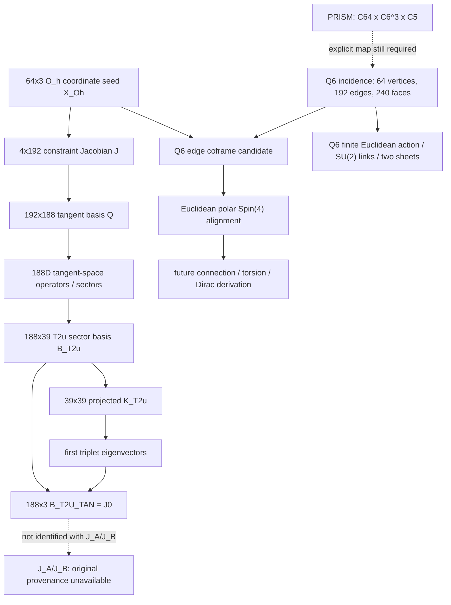

# RGS–PSU matrix lineage and dependency audit

**Audit date:** 2026-11-04  
**Scope:** repository-resident reports, source files and array provenance.  
**Status:** source-level reconstruction; not every binary array was independently reloaded in this audit.

## Executive result

The repository supports a defensible partial chain:

\[
X_{O_h}\ (64\times3)
\longrightarrow
J_{\rm constraint}\ (4\times192),\quad
Q\ (192\times188)
\longrightarrow
\text{188D tangent-sector objects}
\longrightarrow
B_{T2u,\rm tan}\ (188\times3).
\]

The Q6 incidence complex is a separate combinatorial input with 64 vertices, 192 edges and 240 square faces. It can be attached to the geometric seed through an explicit vertex/edge ordering and coframe construction, but its incidence data must not be identified with the 188D tangent basis.

PRISM is another graph family, \(C_{64}\square C_6^3\square C_5\), with 69,120 vertices and degree 10. It is **not** the Q6 hypercube graph: \(C_{64}\) is a 64-cycle of degree 2, whereas \(Q_6=(\mathbb Z_2)^6\) has degree 6. Equal vertex count does not imply equal graph, spectrum, incidence or topology.

The continuum/physical bridge (Clifford/Dirac, TEGR, Yang–Mills/QCD, PSU–Anti-Twin) remains a sequence of additional constructions, not a consequence of the finite matrix identities below.

## 1. Matrix registry and provenance

| Object | Shape | Source-backed meaning | Status |
|---|---:|---|---|
| \(X_{O_h}\) | 64×3 | Reconstructed 64-point coordinate seed with \(O_h\) orbit ordering | **Recovered**; source archive identified in the Ellis seed manifest |
| \(J_{\rm constraint}\) | 4×192 | Three translation constraints plus one fixed-radius constraint on flattened 64×3 coordinates | **Reported validated** in A14 |
| \(Q\) | 192×188 | Orthonormal basis for the nullspace of \(J_{\rm constraint}\) | **Reported validated** in A14 |
| \(P_T=QQ^T\) | 192×192 | Tangent projector | **Reported validated** |
| \(P_N\) | 192×192 | Four-dimensional normal projector | **Reported validated** |
| K_tangent_rebuilt | 188×188 | Archived/replayed tangent-space operator supplied to later audits | **Input recovered; relation to original 192×192 energy Hessian not fully established** |
| \(B_{T2u}\) | 188×39 | T2u sector basis in tangent space | **Source-backed by T2u diagnostic bundle** |
| \(K_{T2u}\) | 39×39 | Projected T2u operator \(B_{T2u}^T K_{\rm Coulomb}B_{T2u}\), symmetrised before diagonalisation | **Formula documented** |
| \(B_{T2u,\rm tan}\) | 188×3 | First triplet \(B_{T2u}V_{[:,0:3]}\) | **Reconstructed from explicit formula** |
| J0_rebuilt | 188×3 | Alias of the archived first T2u triplet basis | **Exact byte alias of B_T2U_TAN_rebuilt; formula-level equivalence documented** |
| J_A, J_B | nominally 188×3 in synthetic snippets | Two mock matter-channel bases in a recovered notebook | **Original definitions NOT RECOVERABLE; not verified physical inputs** |
| K0, Kinv, K_geometry_tangent | 188×188 | Distinct archived operators/bundles | **Do not relabel as original constrained energy Hessian without derivation** |

### A14 constraint construction

The A14 report defines, for \(X=(X_1,\ldots,X_{64})\in\mathbb R^{192}\),

\[
F(X)=\left(
\sum_i X_i^x,\sum_i X_i^y,\sum_i X_i^z,
\frac12\left(\sum_i\|X_i\|^2-R^2_{\rm ref}\right)
\right).
\]

Its Jacobian \(J_{\rm constraint}=DF(X)\) has three uniform translation rows and one radial row. The report gives:

- rank \(J=4\), hence nullity \(192-4=188\);
- \(Q\in\mathbb R^{192\times188}\);
- \(\|JQ\|_F=1.2385465290863038\times10^{-14}\);
- \(\|Q^TQ-I_{188}\|_F=1.3145467710370518\times10^{-14}\);
- archived-vs-SVD tangent projector difference \(=0\);
- tangent/normal projector complement residual \(=9.013175987547113\times10^{-15}\).

These values are recorded in data/rgs_188d/A14_jacobian_report.json. The report explicitly says this validates the constraint Jacobian and tangent basis, **not** the original 192×192 energy Hessian or its claimed spectral decomposition.

### T2u triplet reconstruction

The T2u provenance record gives:

\[
B_{T2u}\in\mathbb R^{188\times39},\qquad
K_{T2u}=B_{T2u}^T K_{\rm Coulomb}B_{T2u},
\]

\[
B_{T2u,\rm tan}
=B_{T2u}V_{[:,0:3]}
\in\mathbb R^{188\times3}.
\]

The archived first-triplet array is T2U_DATA__V_first_triplet; the reconstruction report records zero relative difference against that archive. It explicitly states

\[
B_{T2u,\rm tan}=J0=T2U\_DATA\_V\_first\_triplet.
\]

Therefore, the identical Git blob for B_T2U_TAN_rebuilt.npy and J0_rebuilt.npy is not by itself evidence of a bad duplicate: the T2u provenance document gives a specific mathematical reason for the alias. Byte identity is established by the shared Git blob SHA; mathematical interpretation is supported by the T2u reconstruction report.

### J_A / J_B quarantine

The separate J reconstruction report identifies the recovered notebook constructions as \(J_A=J+0.01\,\mathrm{noise}\), \(J_B=J+0.01\,\mathrm{noise}\), plus random Gaussian fallbacks. These are synthetic mock constructions, not a verified derivation from \(X_{O_h},Q,K_{\rm tangent}\). The repository's verdict is NOT_RECOVERABLE. Do not use these arrays as physical matter-sector bases or their downstream outputs as validated RGS predictions.

## 2. Q6 incidence layer

The canonical Q6 combinatorics are:

- vertices: \(V=(\mathbb Z_2)^6\), \(|V|=64\);
- edges: 192, each joining \(g\) to \(g\oplus2^a\);
- square faces: 240;
- oriented incidence maps \(B_1:C_1\to C_0\) and \(B_2:C_2\to C_1\).

The canonical recovered incidence archive reports:

\[
B_1B_2=0,\quad
\operatorname{rank}B_1=63,\quad
\operatorname{rank}B_2=129.
\]

It also records \(\operatorname{nnz}(B_1)=384\) and \(\operatorname{nnz}(B_2)=960\). The graph cycle rank is \(192-64+1=129\). This graph cycle rank is not the same as the homology of the 2-skeleton after attaching the 240 faces.

The Q6 README identifies Q6_exact_incidence_and_H241.npz as the canonical source for orientation and incidence ordering. The separate Q6_edges.npy / Q6_faces.npy arrays and edge ordering in the Ellis seed manifest must be cross-checked before treating them as ordering-identical to the canonical NPZ. Preserve source ordering; do not regenerate and silently substitute it.

## 3. Geometry-to-Q6 attachment

The Ellis curved-seed manifest records a deterministic construction:

1. take the 64-point \(X_{O_h}\in\mathbb R^3\) seed from the A14 source archive;
2. order Q6 edges by \(g=0,\ldots,63\) and bit axis \(a=0,\ldots,5\), adding \((g,g\oplus2^a,a)\) when bit \(a\) of \(g\) is zero;
3. define the raw edge coframe as
   \[
   e_{gh}^{\rm raw}=(X_h-X_g,\ \|X_h\|-\|X_g\|)\in\mathbb R^4;
   \]
4. optionally normalise each edge coframe by its Euclidean \(\mathbb R^4\) norm.

The manifest reports 56 distinct rays and 8 repeated-ray vertices. It explicitly warns that the archived Q6 link coframe is not automatically the same as a later tetrahedral coframe, and that the Q6 2-skeleton is not a tetrahedral mesh.

This gives a reproducible candidate attachment of the 64-point geometry to the Q6 graph, conditional on using the same edge order and normalisation. It does not yet define a unique discrete Levi-Civita or teleparallel connection.

## 4. PRISM is a distinct product graph

The declared PRISM graph is

\[
G_{\rm PRISM}=C_{64}\square C_6\square C_6\square C_6\square C_5.
\]

Its vertex count and degree follow exactly from the Cartesian product:

\[
|V|=64\cdot6^3\cdot5=69120,
\qquad
\deg(G)=2+2+2+2+2=10.
\]

The first factor \(C_{64}\) is a cycle graph, not the 6-cube \(Q_6\). Both have 64 vertices, but their degree sequences, adjacency matrices, spectra and cycle structures differ. The set-theoretic identification of 64 labels is not a graph isomorphism.

The defensible architecture is therefore:
- Q6 supplies a 64-state hypercube incidence/plaquette complex;
- the \(O_h\) coordinate seed supplies a geometric embedding of 64 labelled states;
- PRISM supplies a separate 69,120-state product graph;
- any map from Q6 labels into the C64 factor, or from Q6 into PRISM fibres, must be explicitly defined and tested for injectivity, adjacency preservation, incidence preservation and equivariance.

No such map is inferred from cardinality alone.

## 5. Spin/Clifford, PSU and gauge layers

The current Q6 Spin(4) module uses a polar alignment of neighbouring Euclidean coframes:

\[
A_{v\leftarrow u}=e_ve_u^{-1}=R_{v\leftarrow u}P_{v\leftarrow u},
\qquad R\in SO(4),
\]

then lifts \(R\) to Spin(4) with Euclidean gamma matrices. The module checks Clifford relations and spin intertwining. Its own specification limits the interpretation: this is a polar frame-alignment prescription, not automatically a Levi-Civita connection; it is Euclidean Spin(4), not Lorentzian Spin(1,3); no torsion tensor, Cartan equation, TEGR action or Dirac kinetic operator is established by it.

The unified Q6 action is a finite-dimensional Euclidean action with vertex coframes, SU(2) links and two complex SU(2) doublets. Its terms include a fixed-frame coframe smoothness regulariser, Wilson plaquettes, covariant graph hopping, sheet-locking and quartic terms. The repository explicitly states:
- the coframe regulariser is not Einstein–Hilbert or TEGR;
- the hopping term is not a fermionic Dirac kinetic term;
- the two fields are a candidate two-sheet encoding, not proof of a physical Anti-Twin sector;
- no continuum/Mosco limit or Lorentzian dynamics is established.

Thus Q6 currently has a tested finite Euclidean gauge/matter prototype, while the gravity/fermion interpretation remains an open extension.

## 6. Dependency graph

## 7. Open gates before claiming a unified physical theory

1. **Recover the original 192×192 energy Hessian H** and its action/constraint convention; only then certify \(K_{\rm tangent}=Q^THQ\).
2. **Resolve operator identity:** compare K0, K_S, K_A, K_geometry_tangent, K_tangent_rebuilt, Kinv and Kinv_rebuilt by formula, not filename or shape.
3. **Rebuild the T2u projection from source arrays** and store hashes for all_T2u_arrays.npz, K_tangent_rebuilt.npy, the basis and eigenvectors. The current report still says the input SHA-256 values were not computed.
4. **Create one canonical Q6 incidence bundle** in the repository with orientation, edge order, square order and hashes; check the .npy copies against it.
5. **Define the Q6-to-PRISM map** and prove exactly which graph/complex structures it preserves.
6. **Derive a compatible discrete connection** from coframes, rather than equating polar alignment with Levi-Civita or Weitzenböck connection.
7. Only then formulate a Lorentzian Spin(1,3)/Pin structure, torsion/TEGR action, fermionic Dirac operator and continuum convergence theorem.
8. Keep the finite 2I element table, S3/2I measure convergence, Mosco refinement, and physical Anti-Twin/QAT claims as separate open tasks until independently verified.

## 8. Evidence files

- data/rgs_188d/A14_jacobian_report.json
- data/rgs_188d/188D_J_RECONSTRUCTION_PROVENANCE.md
- data/rgs_188d/188D_J_RECONSTRUCTION_REPORT.json
- data/rgs_188d/188D_T2U_RECONSTRUCTION_PROVENANCE.md
- data/rgs_188d/188D_T2U_RECONSTRUCTION_REPORT.json
- data/rgs_188d/ellis_curved_seed_manifest.json
- data/q6/README.md
- docs/recovered-rgs-psu-artifacts.md
- docs/Q6_DISCRETE_SPIN_CLIFFORD_TRANSPORT.md
- docs/UNIFIED_Q6_VARIATIONAL_CORE.md
- docs/UNIFIED_Q6_EULER_LAGRANGE.md
- docs/Q6_ANALYTIC_GRADIENTS_AND_SPIN_CONNECTION_GATE.md
- docs/RGS_PSU_PRISM_QLG_UNIFIED_GEOMETRIC_THEORY.md

**Final classification:** A14 constraint/tangent identities and Q6 incidence identities are reported exact/numerically validated finite results; the T2u first triplet has a documented reconstruction formula; the original J_A/J_B definitions are unrecoverable; PRISM/Q6 attachment and the geometric-to-physical continuum bridge remain explicit research tasks.
