# Unified theorem dependency graph — cross-repository arrows

This file records **directed, typed edges** between specific mathematical records in the two repositories. The machine-readable registry contains all 236 Markdown theorem records from `theorem`, all 14 entries in the companion catalogue, 8 thematic hubs, application dossiers and companion-document nodes. Each theorem has a provisional filename-based thematic-index arrow; this is explicitly not a proof dependency. The 54 direct crosswalk arrows are separately typed and caveated. An arrow is never an unqualified implication: its relation type and evidential force are stated explicitly. Original theorem identifiers and source files remain canonical.

## 1. Graph

```mermaid
flowchart TD
  subgraph T["theorem — theorem records and application dossiers"]
    T055["T055 · Q6 dyadic subdivision"]
    T060["T060 · Kathara → Q3 chain map"]
    T062["T062 · Kathara → Q6 chain map"]
    T063["T063 · SU(2) ↠ SO(3)"]
    T068["T068 · barycentric covariance"]
    T079["T079 · Morandotti structured gradients"]
    T091["T091 · Frank–Burgers tensor law"]
    T098["T098 · two-circle / Vesica duality"]
    T099["T099 · non-affine Vesica / Koopman"]
    P1["Pellis 01 · Poincaré / scalar spectrum"]
    P2["Pellis 02 · PRISM / Kathara / Krist-All"]
    P3["Pellis 03 · self-adjoint operators"]
    P4["Pellis 04 · golden spheres / resonance"]
    M1["Morandotti dossier · Vesica / generalizations"]
    M2["Morandotti defect benchmark · C0-IPDG / refinement"]
    VJ["Vesica–Star-David–Jitterbug bridge"]
  end
  subgraph Q["rgs-qlg-quaternion-bridge — operators, geometry and audits"]
    D55["Q6 dyadic subdivision chain map"]
    KC["Kathara–Q6 Gate C"]
    KD["Kathara–Q6 Gate D"]
    Q2I["Q6–2I intertwiner compatibility"]
    BF["Q6 barycentric P1 FEM"]
    AG["Q6 analytic gradients / spin-connection gate"]
    MOS["Curved Ellis–RGS Mosco programme"]
    D5["Q6–D5 Bergman–Liouville pullback"]
    UNI["RGS–PSU–PRISM–QLG unified geometry"]
    SPIN["Ellis intrinsic spin Dirac / Levi-Civita"]
  end

  T055 -->|same subdivision theorem; companion implementation| D55
  T060 -->|Q3 predecessor; not a Q6 identification| T062
  T062 -->|explicit chain-map construction; degenerate R2=0| KC
  KC -->|nondegenerate / canonical lift still open| KD
  T063 -->|quaternion and double-cover conventions| Q2I
  T063 -->|spin lift prerequisite, not a complete bundle map| SPIN
  T068 -->|barycentric moment input; not the FEM proof| BF
  T079 -->|surface-gradient problem / analytic gate| AG
  T079 -->|continuum transfer remains conditional| MOS
  T091 -->|candidate mechanics/defect application; no constitutive identity| AG
  T098 -->|two-circle geometric generator| VJ
  T099 -->|non-affine phase parameter; bridge map still conditional| VJ
  P1 -->|2I representation input; scalar spectrum is a separate audit| Q2I
  P2 -->|shared PRISM/Kathara architecture| UNI
  P2 -->|chain-level implementation and obstruction| KC
  P3 -->|operator realization and convergence obligations| SPIN
  P3 -->|self-adjoint/variational analytic programme| MOS
  P4 -->|D5/Bergman/Liouville comparison| D5
  M1 -->|geometric source and phase bridge| VJ
  M1 -->|barycentric discretization interface| BF
  M2 -->|structured-gradient / refinement questions| MOS
  BF -->|finite-dimensional input only; no Mosco implication| MOS
  D55 -->|refinement candidate; not automatic convergence| MOS
  UNI -->|architecture only; sector maps must be proved separately| SPIN
```

## 2. Edge register

| From | To | Relation | Force / caveat |
|---|---|---|---|
| T055 | Q6_DYADIC_SUBDIVISION_CHAIN_MAP.md | companion implementation | Exact subdivision identities; historical-array permutation still separate |
| T060 | T062 | refinement of target | T060 lands in Q3; T062 is a distinct explicit Q6 map |
| T062 | KATHARA_Q6_CHAIN_MAP_GATE_C.md | companion construction | Same root-path map; all 2-cells collapse because (R_2=0) |
| Gate C | KATHARA_Q6_NONDEGENERATE_GATE_D.md | open successor | Canonicality and nondegenerate cellular lift are not established |
| T063 | Q6_2I_INTERTWINER_COMPATIBILITY.md | representation-theoretic input | Central-character obstruction/twist is separate from geometric bundle identification |
| T063 | ELLIS_RGS_LEVI_CIVITA_SPIN_CONNECTION.md | spin-lift prerequisite | SU(2) convention does not itself prove the curved spin connection |
| T068 | Q6_BARYCENTRIC_P1_FEM.md | shared barycentric data | T068 is a triangle covariance/quadrature theorem; Q6 edge FEM is a distinct construction |
| T079 | Q6_ANALYTIC_GRADIENTS_AND_SPIN_CONNECTION_GATE.md | analytic interface | Surface gradient and spin-connection compatibility remain separate obligations |
| T079 | RGS_MOSCO_CURVED_REFINEMENT_PROGRAM.md | continuum research dependency | Candidate shell transfer is not a Mosco theorem |
| T091 | RGS_EC_ALGEBRAIC_AXIAL_TORSION_BENCHMARK.md | application comparison | Discrete stress-jump tensor is not a torsion law or constitutive identity |
| T098 | VESICA_STAR_DAVID_JITTERBUG_PHASE_BRIDGE.md | geometric source | Two-circle / opposite-triangle construction feeds the geometric crosswalk |
| T099 | VESICA_STAR_DAVID_JITTERBUG_PHASE_BRIDGE.md | phase-parameter interface | Non-affine Vesica parameter is not identified with Jitterbug angles |
| Pellis 01 | Q6_2I_INTERTWINER_COMPATIBILITY.md | representation input | 2I representation theory informs the quotient sector; does not prove scalar spectral multiplicities |
| Pellis 02 | RGS_PSU_PRISM_QLG_UNIFIED_GEOMETRIC_THEORY.md | programme alignment | Shared architecture; each sector needs its own map/action |
| Pellis 02 | KATHARA_Q6_CHAIN_MAP_GATE_C.md | chain-level audit | Explicit chain map is degenerate and not canonical |
| Pellis 03 | ELLIS_RGS_INTRINSIC_SPIN_DIRAC.md | operator realization | Finite-mesh operator, convergence and self-adjoint domains must be distinguished |
| Pellis 03 | RGS_MOSCO_CURVED_REFINEMENT_PROGRAM.md | analytic gate | Scalar Mosco programme does not prove spinorial convergence |
| Pellis 04 | Q6_D5_BERGMAN_LIOUVILLE_PULLBACK_THEOREM.md | analytic comparison | Exact invariant-measure theorem is distinct from spectral/resonance claims |
| Morandotti dossier | VESICA_STAR_DAVID_JITTERBUG_PHASE_BRIDGE.md | geometric source | Vesica → hexagram/Jitterbug map has explicitly open incidence/cinematic gates |
| Morandotti dossier | Q6_BARYCENTRIC_P1_FEM.md | discretization interface | Cellwise barycentric moments and edge P1 FEM are distinct objects |
| Morandotti defect benchmark | RGS_MOSCO_CURVED_REFINEMENT_PROGRAM.md | refinement/continuum gate | Flat or finite-level checks do not prove curved Mosco convergence |
| Q6_BARYCENTRIC_P1_FEM | RGS_MOSCO_CURVED_REFINEMENT_PROGRAM | possible input | No implication: a finite edge FEM is not the curved refinement family |
| Q6_DYADIC_SUBDIVISION_CHAIN_MAP | RGS_MOSCO_CURVED_REFINEMENT_PROGRAM | possible refinement input | Commuting subdivision alone does not give shape regularity or Mosco convergence |
| Unified geometry | Ellis spin Dirac | architecture-to-sector link | Proposed architecture only; no single derived action asserted |

## 3. Canonical source links

### theorem repository
- [T055](https://github.com/fabianleonaressi95/theorem/blob/main/theorems/T055-q6-dyadic-subdivision-chain-map.md)
- [T060](https://github.com/fabianleonaressi95/theorem/blob/main/theorems/T060-kathara-q3-chain-map.md)
- [T062](https://github.com/fabianleonaressi95/theorem/blob/main/theorems/T062-kathara-q6-integral-chain-map.md)
- [T063](https://github.com/fabianleonaressi95/theorem/blob/main/theorems/T063-quaternion-su2-so3-double-cover.md)
- [T068](https://github.com/fabianleonaressi95/theorem/blob/main/theorems/T068-barycentric-covariance-quadrature-law.md)
- [T079](https://github.com/fabianleonaressi95/theorem/blob/main/theorems/T079-morandotti-surface-gradient-barycentre-bridge.md)
- [T091](https://github.com/fabianleonaressi95/theorem/blob/main/theorems/T091-frank-burgers-tensorial-anisotropy-composition-law.md)
- [T098](https://github.com/fabianleonaressi95/theorem/blob/main/theorems/T098-two-circle-positive-gradient-negative-barycentre-duality.md)
- [T099 non-affine Vesica](https://github.com/fabianleonaressi95/theorem/blob/main/theorems/T099-nonaffine-vesica-parameter-koopman-bridge.md)
- [Pellis dossiers](https://github.com/fabianleonaressi95/theorem/tree/main/collaborations/pellis)
- [Morandotti briefing](https://github.com/fabianleonaressi95/theorem/blob/main/docs/MORANDOTTI_BRIEFING_2026-11-11.md)
- [Morandotti defect benchmark](https://github.com/fabianleonaressi95/theorem/tree/main/docs/rgs_defect_benchmark)

### RGS–QLG quaternion bridge repository
- [Q6 dyadic subdivision](https://github.com/fabianleonaressi95/rgs-qlg-quaternion-bridge/blob/main/docs/Q6_DYADIC_SUBDIVISION_CHAIN_MAP.md)
- [Kathara Gate C](https://github.com/fabianleonaressi95/rgs-qlg-quaternion-bridge/blob/main/docs/KATHARA_Q6_CHAIN_MAP_GATE_C.md)
- [Kathara Gate D](https://github.com/fabianleonaressi95/rgs-qlg-quaternion-bridge/blob/main/docs/KATHARA_Q6_NONDEGENERATE_GATE_D.md)
- [Q6–2I compatibility](https://github.com/fabianleonaressi95/rgs-qlg-quaternion-bridge/blob/main/docs/Q6_2I_INTERTWINER_COMPATIBILITY.md)
- [Q6 barycentric P1 FEM](https://github.com/fabianleonaressi95/rgs-qlg-quaternion-bridge/blob/main/docs/Q6_BARYCENTRIC_P1_FEM.md)
- [Analytic gradient gate](https://github.com/fabianleonaressi95/rgs-qlg-quaternion-bridge/blob/main/docs/Q6_ANALYTIC_GRADIENTS_AND_SPIN_CONNECTION_GATE.md)
- [Curved Mosco programme](https://github.com/fabianleonaressi95/rgs-qlg-quaternion-bridge/blob/main/docs/RGS_MOSCO_CURVED_REFINEMENT_PROGRAM.md)
- [D5 Bergman–Liouville pullback](https://github.com/fabianleonaressi95/rgs-qlg-quaternion-bridge/blob/main/docs/Q6_D5_BERGMAN_LIOUVILLE_PULLBACK_THEOREM.md)
- [Unified RGS–PSU–PRISM–QLG architecture](https://github.com/fabianleonaressi95/rgs-qlg-quaternion-bridge/blob/main/docs/RGS_PSU_PRISM_QLG_UNIFIED_GEOMETRIC_THEORY.md)
- [Intrinsic spin Dirac](https://github.com/fabianleonaressi95/rgs-qlg-quaternion-bridge/blob/main/docs/ELLIS_RGS_INTRINSIC_SPIN_DIRAC.md)

## 4. Rules for extending the graph

1. Add an edge only after opening both endpoint records and identifying the shared mathematical object or the exact dependency.
2. Use one of: `proves`, `implements`, `uses-definition`, `representation-input`, `discretizes`, `candidate-successor`, `application-of`, `comparison-only`, `open-obligation`.
3. Never infer `proves` from a passing test, shared vocabulary, or a common finite graph.
4. Keep proof dependencies separate from programme/application links.
5. Record open gates on the edge itself; do not silently upgrade candidates to theorems.
6. Every new theorem in either repository must be attached to at least one existing node or explicitly marked as a new independent root.

## Reciprocal repository index

The theorem-side copy of this graph is maintained at [the theorem repository graph](https://github.com/fabianleonaressi95/theorem/blob/docs/unified-two-repository-theorem-program/docs/UNIFIED_THEOREM_DEPENDENCY_GRAPH.md). Machine-readable edges: [UNIFIED_THEOREM_EDGES.json](UNIFIED_THEOREM_EDGES.json).

## 5. Full-coverage inventory and interpretation

The machine-readable edge registry now contains **289 nodes and 320 directed edges**:

- 236 theorem-record nodes from `theorem/theorems/`;
- 14 catalogue-entry nodes from the companion `results/catalogue/laws_theorems_registry.json`;
- 8 thematic hubs, plus application-dossier and companion-document nodes;
- 236 provisional theorem-to-hub classification arrows, 30 hub-to-companion links, and 54 direct typed crosswalk arrows.

The 236 classification arrows ensure that every theorem file is present in the common graph, but they are **indexing arrows inferred from filenames**, not mathematical proof dependencies. Only direct arrows whose relation and caveat are explicitly recorded may be treated as reviewed crosswalks. The remaining theorem bodies must be audited to replace provisional topic edges with precise dependency, implementation, comparison or independent-root classifications.
